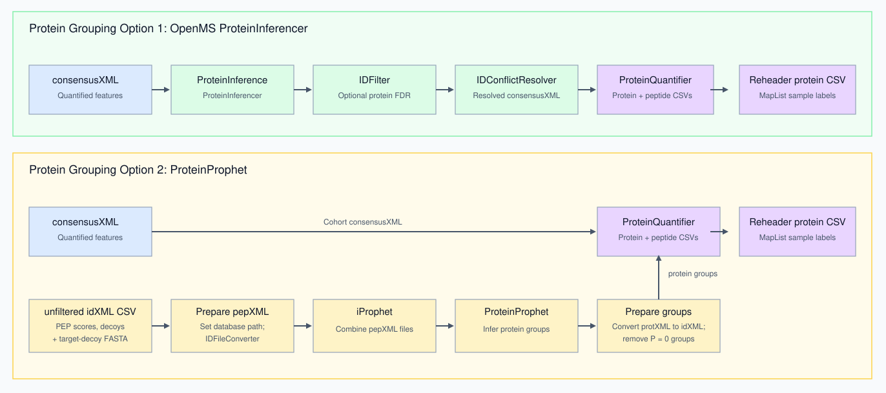

# quantitate-ProteomicProtein

Quantitate proteins and peptides across compatible consensusXML inputs with OpenMS ProteinQuantifier. The pipeline retains two protein grouping workflows.

## Workflows

- **ProteinProphet (default):** Optionally merge the input consensusXML files. For each unfiltered, PEP-scored idXML, set its search database path to the supplied target-decoy FASTA, extract its OpenMS enzyme rule, convert it to pepXML, and repair the enzyme-terminus annotations. Combine the repaired pepXML files with iProphet; run ProteinProphet; convert protXML to idXML; remove groups whose probability is zero; and give the resulting groups to ProteinQuantifier.
- **ProteinInferencer:** Optionally merge consensusXML files, run OpenMS ProteinInference, optionally filter by protein FDR when both `protein_inference_protein_fdr` and `filter_protein_fdr` are true, then resolve identification conflicts and quantify.

The pipeline does not impose LFQ sample grouping or TMT plex logic. Input consensusXML files must already contain compatible quantified features and sample metadata. ProteinProphet combines all provided unfiltered idXML files for cohort level grouping.

## Inputs

Create a CSV with a single `path` column for `input_consensusXML`. For ProteinProphet, create another `path` CSV for `unfiltered_idXML` and provide the matching target-decoy FASTA and decoy prefix. See [example CSV](input/input.csv) and [configuration template](config/template.config).

Key parameters: `output_dir`, `project_name`, `input_consensusXML`, `protein_grouping_algorithm` (`ProteinProphet` or `ProteinInferencer`), `merge_consensus`, `save_intermediate_files`, and the ProteinProphet inputs listed above. The ProteinInferencer branch supports `protein_inference_protein_fdr` and `filter_protein_fdr`. When filtering is enabled, set both switches to `true` and supply `protein_fdr_cutoff` (a protein q-value from 0 inclusive to 1 exclusive); no cutoff is chosen by default. Tool options retain their original parameter names in the modules.

Use `nextflow run main.nf -c /path/to/run.config -profile standard`. The `docker`, `apptainer`, `singularity`, and `local` profiles are also available. The shared configuration submodule must be initialized. The pepXML repair uses `lxml` in the configured FragPipe image. The iProphet and ProteinProphet steps use the Philosopher executable bundled in `fcyucn/fragpipe:24.0`. Resource allocations come from [resources.json](config/resources.json) and can be adjusted with `resource_allocation_profile_tag` and `base_resource_update`.

## Outputs

Under `<output_dir>/quantitate-ProteomicProtein-<version>/<project_name>/OpenMS-<version>/output/`:

| File | Contents |
| --- | --- |
| `<project_name>_ProteinQuantifier_protein.csv` | Protein abundance table |
| `<project_name>_ProteinQuantifier_peptide.csv` | Peptide abundance table |
| Merged or resolved `*.consensusXML` | Published consensusXML, depending on grouping branch and merge option |

Process logs and Nextflow reports are under the sibling timestamped log directory. Optional intermediates are under `intermediate/`. The pipeline does not currently generate mzTab.

## Testing

See [test/README.md](test/README.md) and [`.env-template`](.env-template) for the two NFTest integration cases and required environment variables. They require external fixtures and containers on the cluster.

## Scientific review points

The established workflow combines all idXML files with iProphet before ProteinProphet, removes zero-probability parent groups, and makes protein FDR filtering optional only in the ProteinInferencer branch. For either supported grouping algorithm, a warning is logged when a retained parent contains a zero-scored ProteinHit in an indistinguishable group that ProteinQuantifier may quantify; the warning reports the score type and does not change the groups. These choices can affect protein grouping, shared-peptide attribution, and downstream interpretation.

The separate `extract_enzyme_rule` process reads the digestion enzyme name and cleavage regex from each idXML and passes a JSON rule file alongside it through conversion. The pepXML repair checks the enzyme name, corrects its cleavage specificity, and recalculates `num_tol_term` for each protein match from its flanking residues. One-residue C-terminal and N-terminal rules are supported; other regexes fail explicitly because the pepXML flanks may not contain enough sequence context. The repair retains the PEP-derived probability in all NTT slots because that score is not separately calibrated by terminus class. Matches with unknown flanks retain their existing NTT and are counted in the process log. OpenMS also writes zero missed cleavages for every hit; this repair does not change that separate field.

## Reference

Rost HL et al. OpenMS: a flexible open-source software platform for mass spectrometry data analysis. *Nature Methods* 2016;13:741–748. doi:10.1038/nmeth.3959.

## License

See [LICENSE](LICENSE).
